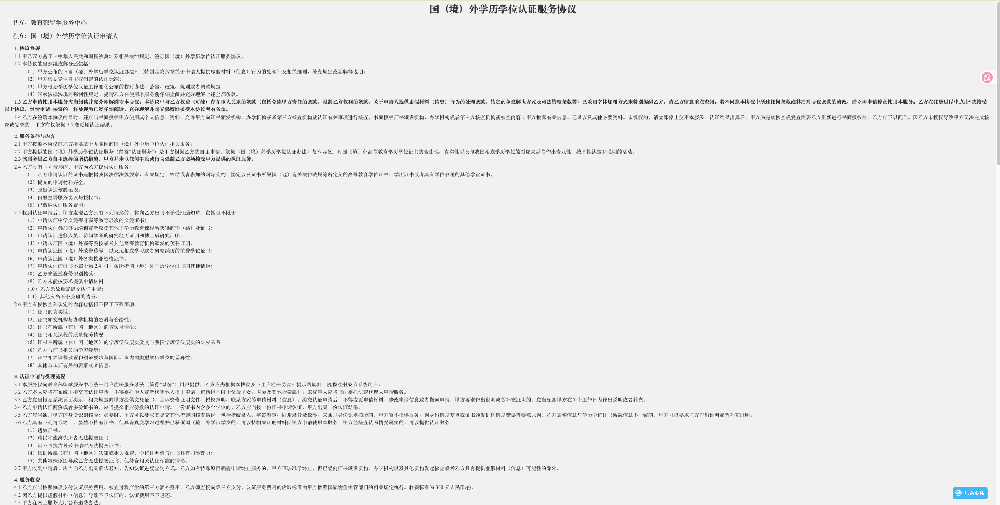
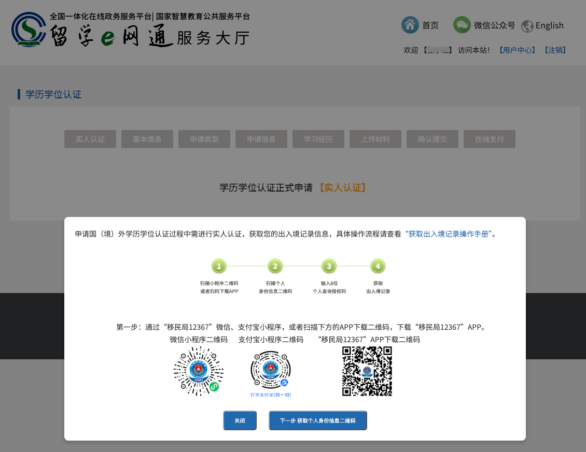
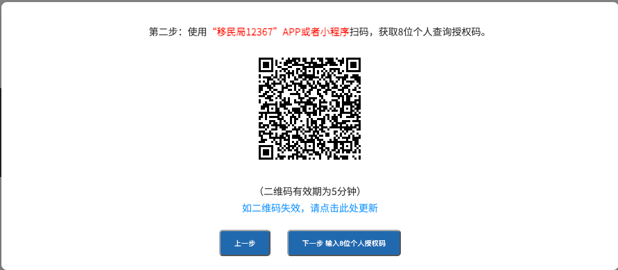
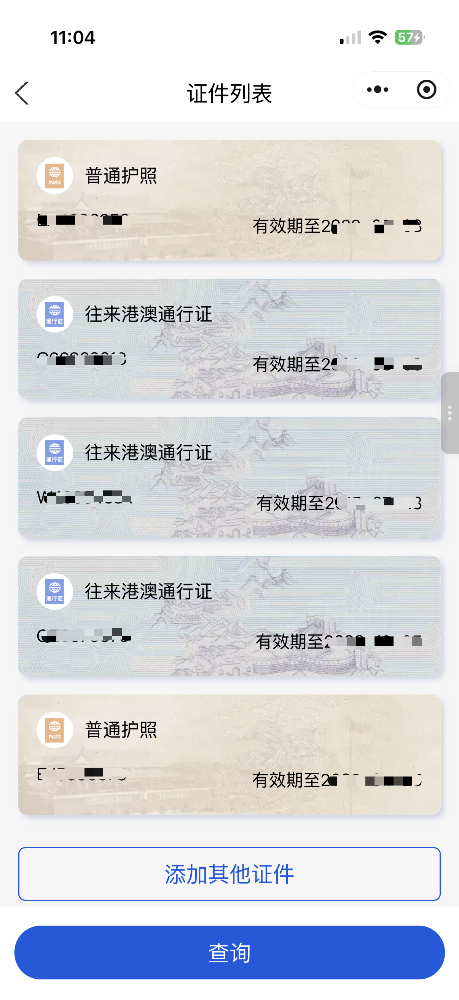
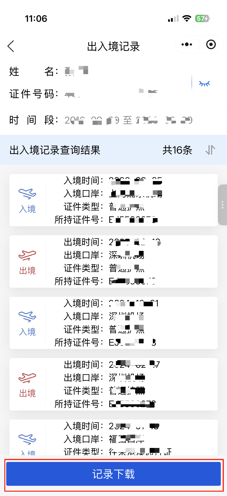
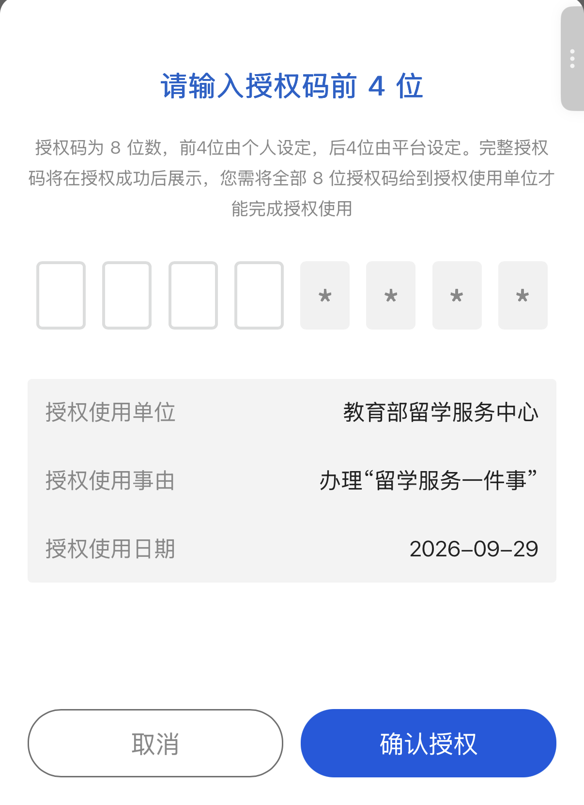
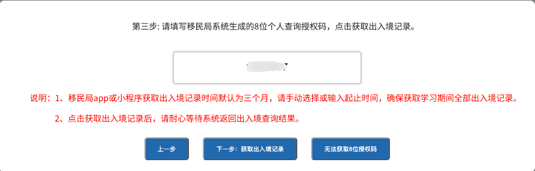
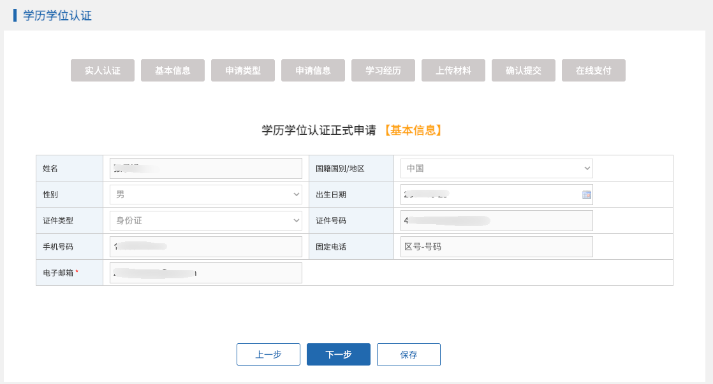
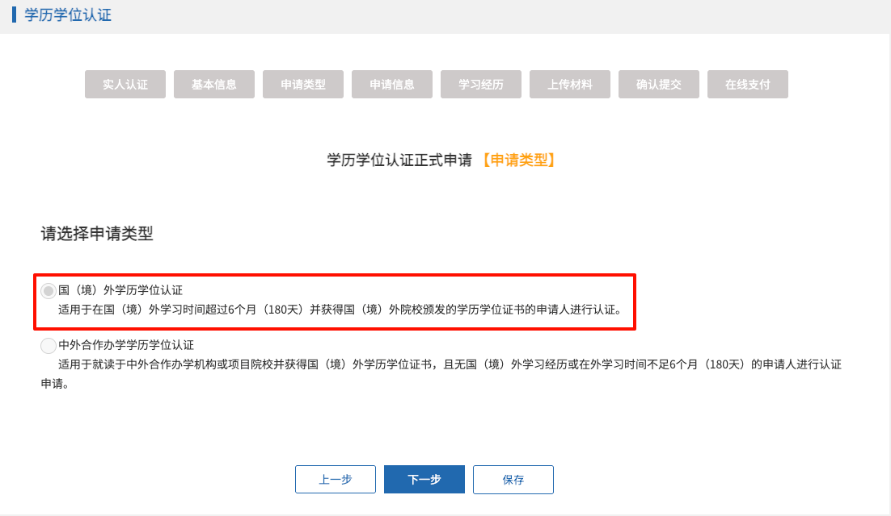
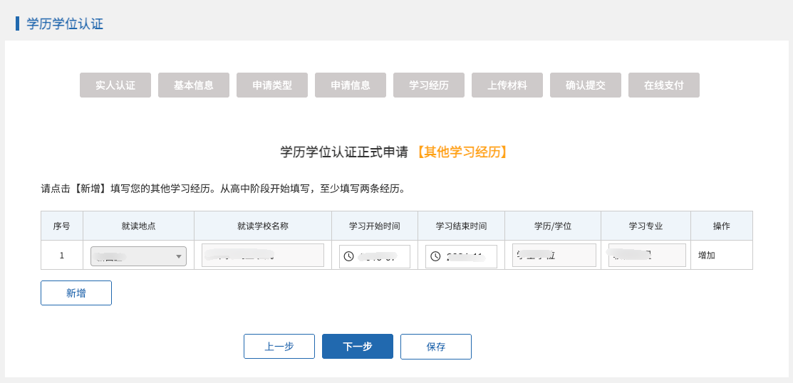

# 国（境）外学历学位认证（留服认证）

在新西兰取得学历学位后，如需申请教育部留学服务中心的国（境）外学历学位认证，可以通过[留服中心网上服务大厅](https://zwfw.cscse.edu.cn/zwfw/lxfwzxwsfwdt2020/xlxwrz32/index.html)在线办理。本指南面向**持中国内地身份证、在新西兰学习的申请人**，根据 2026 年 9 月的实操记录整理，并于 **2026 年 10 月 12 日**核对官方说明。其他身份或学习类型，请在服务大厅选择对应的申请材料说明。

::: tip 办理入口
从[留服中心学历学位认证页面](https://zwfw.cscse.edu.cn/zwfw/lxfwzxwsfwdt2020/xlxwrz32/index.html)进入“在线申请”。申请应由本人提交；页面文字和操作顺序如有变化，以当时系统提示为准。
:::

## 申请前准备

| 材料 | 准备要点 |
| --- | --- |
| 学历学位证书 | 准备需要认证的正式文凭证书。多份证书需分别提交申请。 |
| 护照和签证 | 准备学习期间使用的护照个人信息页、签证页；电子签证或居留卡也需按要求提供。 |
| 证件照片 | 准备本人近期标准证件照，底色不限。 |
| 文凭证书核查授权声明 | 从[官方材料说明](https://zwfw.cscse.edu.cn/zwfw/lxfwzxwsfwdt2020/xlxwrz32/sqcl/ndjm/2026042823583912537/index.html)下载适用模板，使用英文或留学国源语言填写，并由本人亲笔签名。 |
| 辅助材料 | 建议备好学校出具的完整官方成绩单；系统或补材料通知可能要求其他材料。 |

材料仅需在线上传电子版，原件的彩色扫描件应清晰、完整、忠实于原件。上传前按[官方材料说明](https://zwfw.cscse.edu.cn/zwfw/lxfwzxwsfwdt2020/xlxwrz32/sqcl/ndjm/2026042823583912537/index.html)和当前系统页面核对文件格式、大小及特殊情形要求，不要邮寄原件。

## 在线申请步骤

以下截图来自 **2026 年 9 月 29 日**的实操记录，供定位页面和按钮；点击截图可查看原图。实际界面可能变化，二维码和授权码均应使用本人申请页面当前生成的内容。

### 1. 注册并发起申请

在服务大厅选择“学历学位认证”→“在线申请”，用身份证信息完成统一用户身份认证系统的注册、实名认证。登录后进入“办理认证申请”；已有草稿可在用户中心继续办理。

### 2. 阅读服务协议

仔细阅读《国（境）外学历学位认证服务协议》，确认后继续。一个申请对应一份需要认证的证书。

### 3. 授权获取出入境记录

根据电脑页面提示，使用“移民局 12367”App 或微信、支付宝小程序扫码，完成实人认证。电脑页面会显示扫码指引和**临时二维码**；下图二维码只是旧界面示意，办理时请扫描自己当前页面生成的二维码。

在手机端查询出入境记录时，时间范围应覆盖**整个在新西兰学习期间**，不要直接沿用默认的短时间范围。查询记录后选择“记录下载”及“授权使用”，获取 **8 位个人授权码**。

回到电脑页面输入授权码，等待系统获取记录。

### 4. 填写申请信息

核对基本信息，按实际情况选择申请类型，填写新西兰院校、证书和学习经历等信息。申请类型取决于真实就读方式；有中外合作办学经历时，按系统对应类型填写，不要照搬他人的选项。

### 5. 上传材料并提交

在对应栏目上传证书、签署的授权声明、证件和其他所需材料。逐项核对姓名、证书信息、学习时间及附件，再确认提交。

### 6. 在线支付

官方公布的认证费为 **360 元/份**。完成支付后，在“用户中心—我的申请”查看状态和通知。

::: warning 出入境记录不完整时
如系统取得的记录未覆盖全部留学时间，按[官方材料要求](https://zwfw.cscse.edu.cn/zwfw/lxfwzxwsfwdt2020/xlxwrz32/sqcl/ndjm/2026042823583912537/index.html)通过“移民局 12367”App 或小程序下载完整记录 PDF 并提交；仍不完整时，可能还需提供护照出入境盖章页或出入境管理部门出具的证明。以系统的补材料通知为准。
:::

## 提交后怎么查

在“用户中心—我的申请”查看进度。如收到补材料通知，按通知要求补充。按[官方指南](https://www.cscse.edu.cn/zwfw/lxfwzxwsfwdt2020/xlxwrz32/qtxx/2026042823585825550/index.html)的分类，**新西兰大部分院校为 15 个工作日以内**；院校核查反馈、节假日或补材料可能使周期延长，且不提供加急服务。认证完成后，可在服务大厅获取电子版结果。

## 官方依据

- [留服中心网上服务大厅：学历学位认证](https://zwfw.cscse.edu.cn/zwfw/lxfwzxwsfwdt2020/xlxwrz32/index.html)（入口、流程、进度查询）
- [国（境）外学历学位认证指南](https://www.cscse.edu.cn/zwfw/lxfwzxwsfwdt2020/xlxwrz32/qtxx/2026042823585825550/index.html)（受理范围、申请流程、费用与时限）
- [申请材料说明：适用于中国内地居民](https://zwfw.cscse.edu.cn/zwfw/lxfwzxwsfwdt2020/xlxwrz32/sqcl/ndjm/2026042823583912537/index.html)（材料、授权声明、出入境记录）

---
*最后核对：2026-10-12 · 根据 2026-09-29 实操记录整理*
