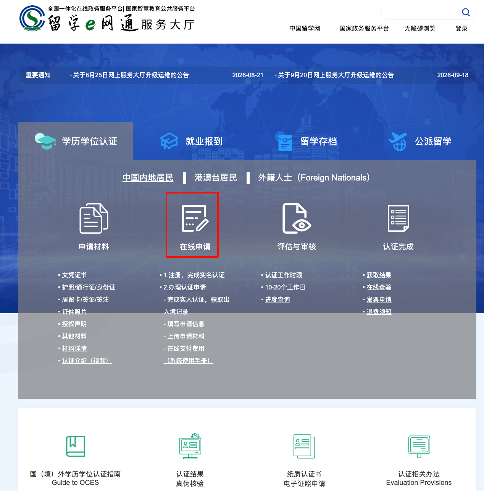
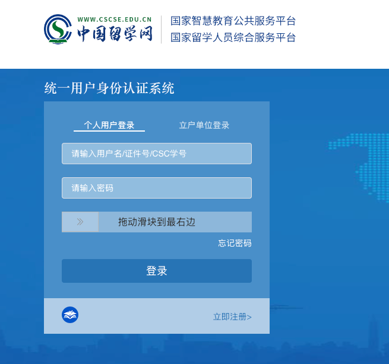
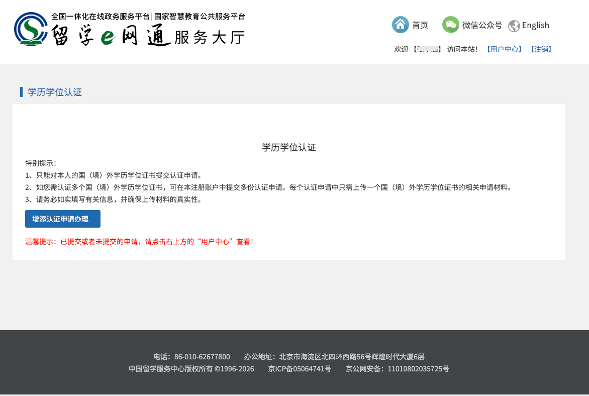
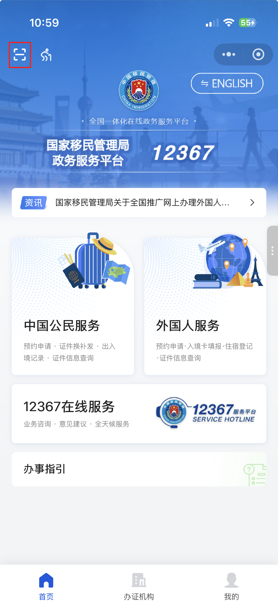
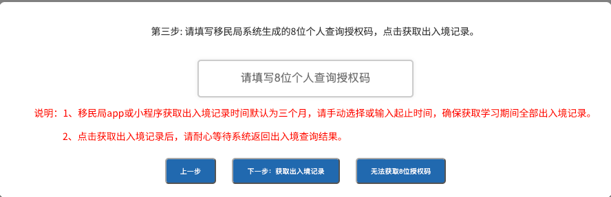
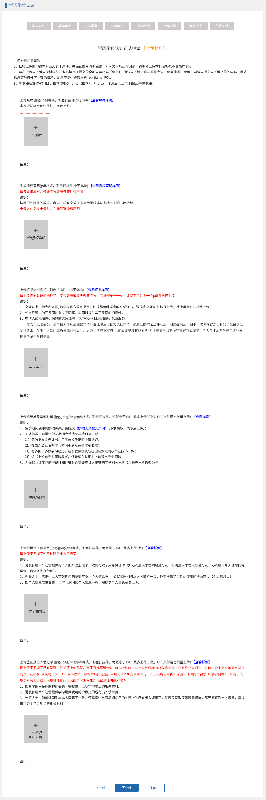
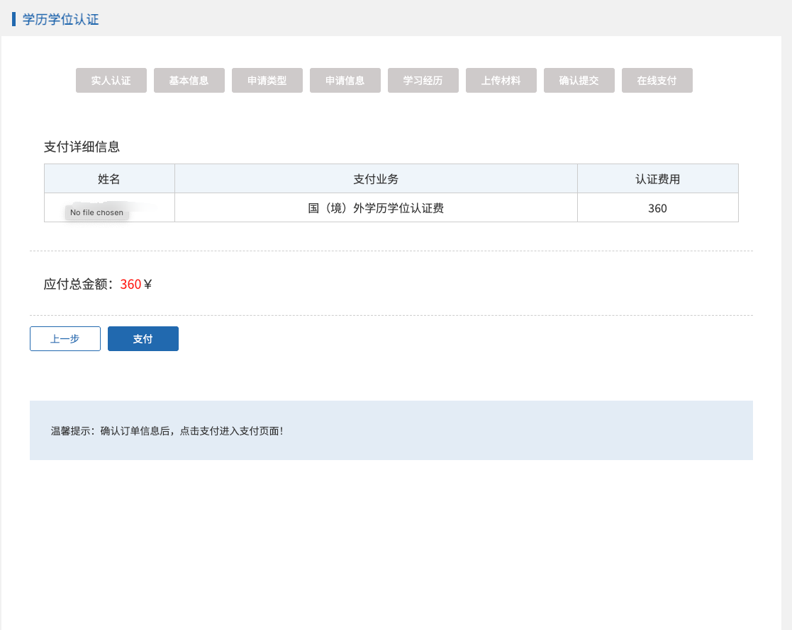

# Overseas Degree Credential Evaluation

If you earned a degree in New Zealand and need it evaluated by the Chinese Service Center for Scholarly Exchange (CSCSE), you can apply through its [online service hall](https://zwfw.cscse.edu.cn/zwfw/lxfwzxwsfwdt2020/xlxwrz32/index.html). This guide is for **mainland Chinese residents who studied in New Zealand**. It draws on an application recorded in September 2026 and official guidance checked on **12 October 2026**. Applicants with other identities or study arrangements should consult the relevant materials page in the service hall.

::: tip Where to apply
Open the [CSCSE credential evaluation page](https://zwfw.cscse.edu.cn/zwfw/lxfwzxwsfwdt2020/xlxwrz32/index.html) and select the online application. You must submit your own application. Follow the current portal instructions if labels or steps have changed.
:::

## Prepare your documents

| Item | What to prepare |
| --- | --- |
| Degree certificate | The final certificate to be evaluated. Submit a separate application for each certificate. |
| Passport and visa | Your passport identity page and visas used during your studies, including an electronic visa or residence card where applicable. |
| ID photo | A recent standard photo; any background colour is accepted. |
| Authorization statement | Download the applicable form from the [official materials page](https://zwfw.cscse.edu.cn/zwfw/lxfwzxwsfwdt2020/xlxwrz32/sqcl/ndjm/2026042823583912537/index.html), complete it in English or the language of your study country, and sign it by hand. |
| Supporting documents | An official full transcript is recommended. Additional documents may be requested by the portal or in a follow-up notice. |

Upload clear, complete colour scans of the originals. Check the [official materials requirements](https://zwfw.cscse.edu.cn/zwfw/lxfwzxwsfwdt2020/xlxwrz32/sqcl/ndjm/2026042823583912537/index.html) and current portal for file formats, size limits and special circumstances. You do not need to mail the originals.

## Apply online

These screenshots come from an application recorded on **29 September 2026**. Select a screenshot to view it at full size. Use them to locate controls; the portal may change. Scan the QR code and use the authorization code generated for your own current application.

### 1. Register and start an application

Choose credential evaluation and the online application in the service hall. Register with your mainland Chinese ID and complete identity verification. After signing in, start an application or resume a saved draft in your user centre.

### 2. Read the service agreement

Accept it only after reviewing its terms. Each application covers one certificate.

### 3. Authorize access to exit and entry records

Follow the instructions on your computer using the “Immigration 12367” app or its WeChat or Alipay mini program. Complete identity verification. The portal displays a **temporary QR code**; the code below is only an old example, so scan the one on your own current application page.

On your phone, choose a search range covering your **entire study period in New Zealand**, rather than the short default range. After querying the records, select the download and authorization options to obtain an **eight-digit personal authorization code**.

Enter the code on your computer and wait for the records to load.

### 4. Complete the application

Check your personal details and enter your institution, certificate and study history accurately. Choose the application category that matches your actual study arrangement; cooperative programmes may require a different category.

### 5. Upload and submit

Upload each document in the appropriate field. Check your name, certificate details, study dates and attachments before submitting.

### 6. Pay online

The published fee is **RMB 360 per certificate**. After payment, check notices and progress under “User Centre → My Applications”.

::: warning If your travel record is incomplete
If the records obtained by the portal do not cover your full study period, download the complete PDF from the “Immigration 12367” app or mini program and submit it as directed by the [official materials requirements](https://zwfw.cscse.edu.cn/zwfw/lxfwzxwsfwdt2020/xlxwrz32/sqcl/ndjm/2026042823583912537/index.html). If the record is still incomplete, passport stamps or a record issued by the exit and entry authority may also be required. Follow any request for additional documents in your application.
:::

## After submission

Check “User Centre → My Applications” for updates and respond to any request for additional documents. The [official guide](https://www.cscse.edu.cn/zwfw/lxfwzxwsfwdt2020/xlxwrz32/qtxx/2026042823585825550/index.html) lists **within 15 working days for most New Zealand institutions**. Responses from institutions, holidays or additional documents can extend the process, and there is no expedited service. You can access the electronic result through the service hall once the evaluation is complete.

## Official sources

- [CSCSE online service hall: credential evaluation](https://zwfw.cscse.edu.cn/zwfw/lxfwzxwsfwdt2020/xlxwrz32/index.html)
- [Overseas Credentials Evaluation Service guide](https://www.cscse.edu.cn/zwfw/lxfwzxwsfwdt2020/xlxwrz32/qtxx/2026042823585825550/index.html)
- [Application materials for mainland Chinese residents](https://zwfw.cscse.edu.cn/zwfw/lxfwzxwsfwdt2020/xlxwrz32/sqcl/ndjm/2026042823583912537/index.html)

---
*Last checked: 12 October 2026 · Based on an application recorded on 29 September 2026*
